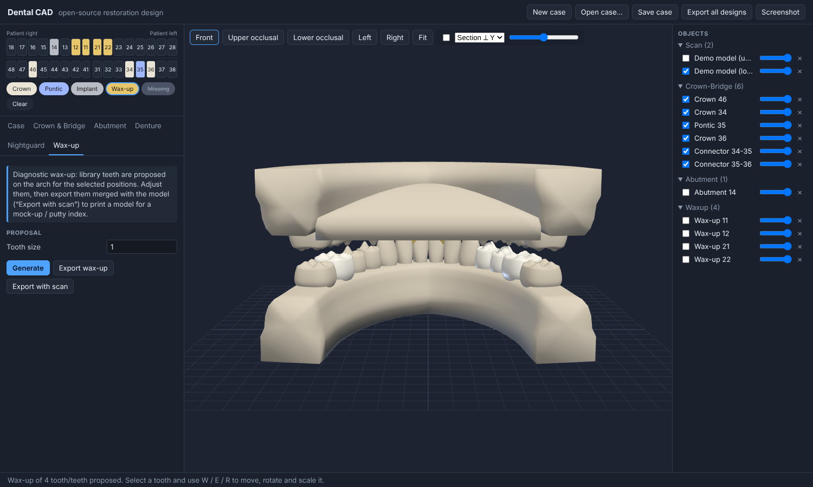

# CAD-APP — open-source dental CAD

Browser-based CAD for the dental lab: **crowns & bridges, custom implant abutments, complete dentures, nightguards and diagnostic wax-ups**. Written in TypeScript with Three.js, no backend required.



> ⚠️ **Not a medical device.** This is an early-stage design tool. Anything it makes must be checked by a qualified dental professional before clinical use. Software that designs patient-specific restorations is a regulated medical device in most markets (FDA Class II in the US, EU MDR).

## Quick start

```bash
npm install
npm run dev        # http://localhost:5173
npm test           # geometry & numbering tests (watertightness, dimensions, layout)
npm run build      # production build in dist/
```

When the app opens it builds procedural **demo models**, so every workflow works without scan data. Import your own STL/PLY/OBJ scans from the **Case** tab.

## Workflow

1. **Tooth chart.** Choose a brush (Crown, Pontic, Implant, Wax-up, Missing) and click teeth. The chart supports FDI and Universal numbering.
2. **Case tab.** Enter the case details, then import upper/lower scans or click *Demo models*. *Pick arch points* fits the arch curve to a scan: click cusp tips from one distal end to the other.
3. **Design tabs.** Each module has a parameter panel and a *Generate* button. If you change a parameter after generating, the design rebuilds automatically.
4. **Adjust.** Click a design object to select it, then press **W**, **E** or **R** to move, rotate or scale it. Bridge connectors follow their units as you move them.
5. **Check & export.** The selection panel shows the triangle count, the volume and whether the mesh is watertight. A section plane lets you inspect wall thickness. Export a binary STL per module or for all designs.

| Module | What it does today |
|---|---|
| **Crown & Bridge** | Full-contour crowns from a parametric tooth library, placed on the arch. The intaglio is fitted to a parametric prep: cement gap, marginal seal zone, margin, axial and occlusal minimum thickness, convergence angle. Adjacent units become bridges: ovate pontics plus elliptical connectors with a set cross-section area (mm²). Basic span checks cover cantilevers and Ante's law. |
| **Abutment** | Custom abutment for an internal-hex implant: hex connection, screw channel, anatomic elliptical emergence profile (concave/convex), shoulder, tapered post and angulation. Checks wall thickness and hex/platform fit. |
| **Denture** | Complete upper and/or lower set-up: a base swept along the arch with buccal and lingual flanges, an optional full palate, and library teeth that can be adjusted one by one. |
| **Nightguard** | Splint built from the arch scan. A height field along the insertion axis blocks out undercuts automatically. Options: flat bite plane or smoothed anatomic surface, minimum thickness, fit gap, coverage depth, wall thickness, outline smoothing. Reports the occlusal thickness it achieved. |
| **Wax-up** | Proposes library teeth at the chosen positions for you to adjust. Exports alone or merged with the model, for printing a mock-up or putty-index model. |


## Architecture

```
src/
  core/        teeth.ts (FDI/Universal, tooth dimensions), arch.ts (arch form, tooth placement), case.ts (case state, JSON save/load)
  geometry/    pure mesh generators, no DOM. Unit-tested.
    MeshBuilder.ts   ring-based indexed mesh builder + watertightness/volume check
    toothShape.ts    procedural tooth library, crown shell, prep die, solid tooth
    connector.ts     bridge connectors
    abutment.ts      parametric abutment
    sweep.ts         profile sweep along the arch, palate slab
    denture.ts       denture base/teeth, procedural demo models
    nightguard.ts    height-field splint generator
  modules/     one file per workflow (UI panel + generate logic)
  viewer/      Three.js viewport (Z-up, orbit, gizmo, picking, section plane)
  io/          STL/PLY/OBJ import, STL export
  ui/          DOM helpers, tooth chart, object list
```

Conventions: units are millimetres and the world is **Z-up**, with +Y anterior and +X the patient's left. Each tooth has a local frame: +x mesiodistal, +y buccal, +z occlusal, with the margin at z = 0. Every generator returns closed, consistently wound meshes. The tests enforce this, because a mesh with holes cannot be milled or printed.

## Roadmap

These are the pieces needed to go from prototype to a production lab tool, roughly in priority order:

1. **Mesh booleans (union/difference).** Bridges, dentures and wax-up models currently export as overlapping closed shells. Most slicers accept that, but milling CAM needs one manifold solid. The plan is [manifold-3d](https://github.com/elalish/manifold) (WASM).
2. **Die-based crown design.** Detect and edit the margin line on the scanned prep, set the insertion axis, block out undercuts, and build the intaglio as an offset of the real die. Today the intaglio is fitted to a parametric prep.
3. **Anatomical tooth library.** Replace the procedural teeth with scanned libraries, adapted by fitting to neighbours and antagonists. Add sculpting tools (add/remove/smooth wax brushes).
4. **Occlusion.** Contact detection and colour maps against the antagonist, a virtual articulator (protrusive/laterotrusive movements) and occlusal adjustment.
5. **Implant libraries.** Connection geometries per implant system (they are proprietary, so this needs manufacturer data), scan-body alignment, screw-retained crowns on abutments, and angled screw channels.
6. **Dentures.** Edentulous-scan outline drawing, tooth set-up rules (occlusal plane, compensating curves), gingival festoon sculpting, and try-in/monolithic export.
7. **Nightguards.** Undercut-retention control, anterior guidance ramps, adjustment against the antagonist bite registration, and smooth (marching-squares) outlines.
8. **Production.** Material-specific minimum thickness checks, nesting/sprue hints, order and lab-management integration, and a DICOM/CBCT viewer for implant planning.

## License

AGPL-3.0, see [LICENSE](LICENSE).
