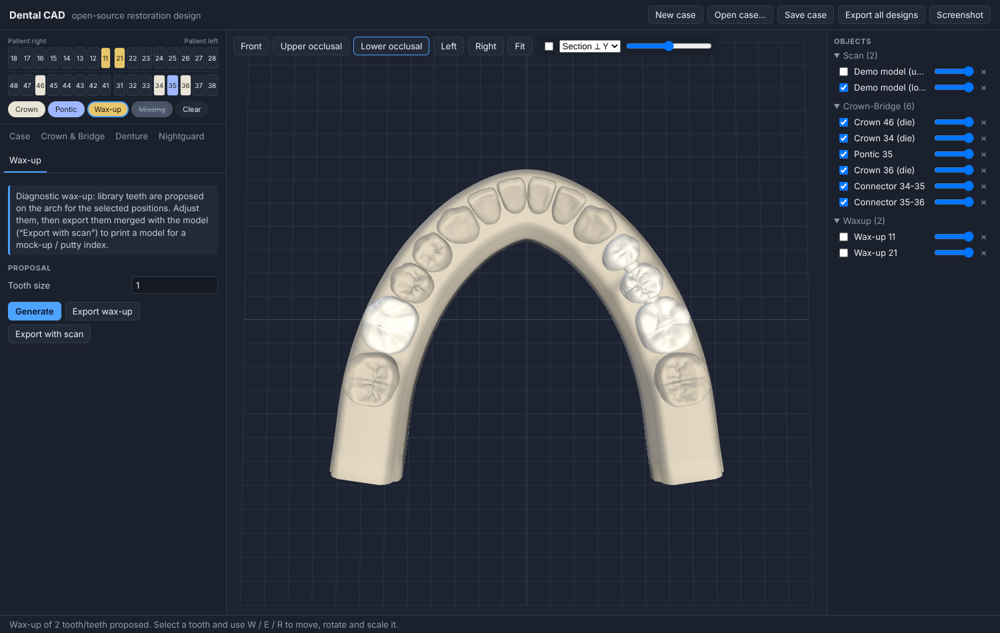
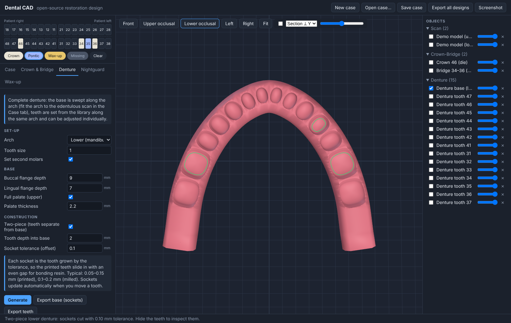
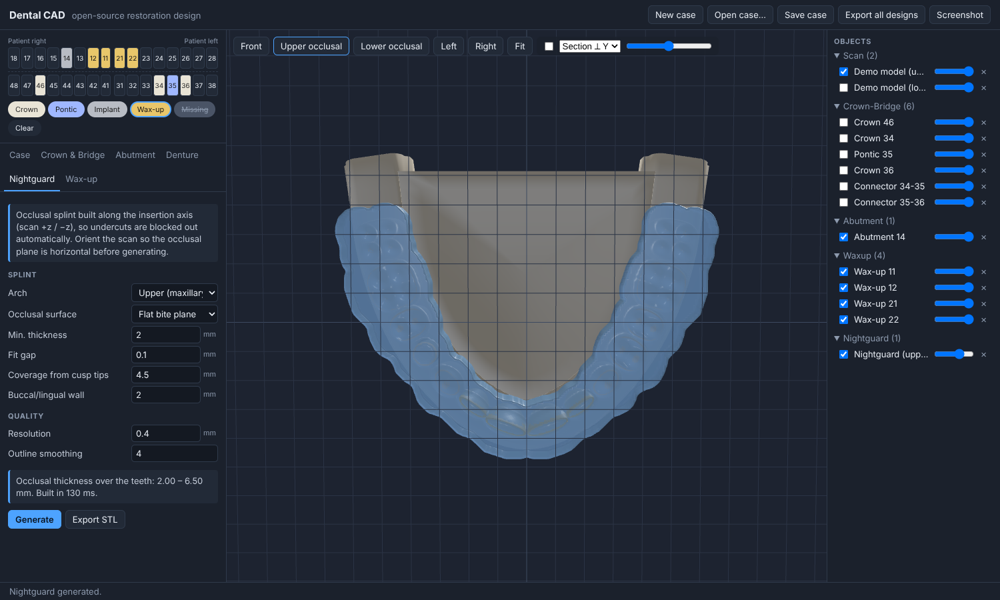

# CAD-APP — open-source dental CAD

Browser-based CAD for the dental lab: **crowns & bridges, complete dentures (one- or two-piece), nightguards and diagnostic wax-ups**. Written in TypeScript with Three.js and [manifold-3d](https://github.com/elalish/manifold) for solid booleans. No backend required.



> ⚠️ **Not a medical device.** This is an early-stage design tool. Anything it makes must be checked by a qualified dental professional before clinical use. Software that designs patient-specific restorations is a regulated medical device in most markets (FDA Class II in the US, EU MDR).

## Quick start

```bash
npm install
npm run dev        # http://localhost:5173
npm test           # geometry, boolean, margin and numbering tests
npm run build      # production build in dist/
```

When the app opens it builds procedural **demo models**, so every workflow works without scan data. Import your own STL/PLY/OBJ scans from the **Case** tab.

## Tooth library

The app ships with a scanned anatomical tooth library: 32 closed crown meshes in `public/library/teeth/`. It is used for denture teeth, wax-ups, pontics, the outer surface of crowns (both die-fitted and on the parametric prep) and the natural teeth of the demo models. Its measured tooth widths also drive the arch layout. You can switch back to procedural teeth in the **Case** tab.

The library is built from an arranged set-up, meaning all teeth in their positions in one coordinate system with one STL per tooth:

```bash
npm run build:library -- path/to/folder-with-stl-files
```

The build script works out the occlusal plane and both arches, numbers the teeth **by their position in the arch** rather than by file name, and moves each tooth into the app's tooth frame (x mesiodistal, y buccal, z occlusal, cervical line on z = 0). It also samples each crown's outer surface around its own long axis, which is what lets crowns be wrapped onto a margin. Exact duplicates are skipped, and anything unusual is reported in the manifest and in the Case tab. For the supplied library: `UNN31.stl` duplicates `UNN30.stl`, so `UNN32`/`UNN33` are #31/#32 (FDI 47/48).

Library crowns end just below the cervical line. Where a tooth has to sit deeper (denture sockets, model gingiva), a root stub is added and fused to it.

## Workflow

1. **Tooth chart.** Choose a brush (Crown, Pontic, Wax-up, Missing) and click teeth. The chart supports FDI and Universal numbering.
2. **Case tab.** Enter the case details, then import upper/lower scans or click *Demo models*. *Pick arch points* fits the arch curve to a scan: click cusp tips from one distal end to the other.
3. **Design tabs.** Each module has a parameter panel and a *Generate* button. If you change a parameter after generating, the design rebuilds automatically.
4. **Adjust.** Click a design object to select it, then press **W**, **E** or **R** to move, rotate or scale it. Bridge connectors follow their units as you move them.
5. **Check & export.** The selection panel shows the triangle count, the volume and whether the mesh is watertight. A section plane lets you inspect wall thickness. Bridges and one-piece dentures export as **one fused manifold solid**.

| Module | What it does today |
|---|---|
| **Crown & Bridge** | **Margin line**: automatic detection on the scanned prep (*Detect*, *Detect at click*, *Detect all crowns*), freehand drawing (*Draw*), and point editing (*Edit points*: click where the line should run and the nearest control point moves there). **Die-fitted crowns**: with a margin, the intaglio follows the scanned die and the library tooth is warped so that its margin lands exactly on the line, with minimum axial/occlusal thickness enforced. **Cement gap**: set the gap and a gap-free band at the margin; the gap ramps in over 0.5 mm. Without a margin, crowns use a parametric prep. Adjacent units become bridges with ovate pontics and connectors sized by cross-section area (mm²). *Merge to solid* / *Export STL* fuse each bridge into one solid with clear intaglios. |
| **Denture** | Complete upper and/or lower set-up: base swept along the arch with buccal/lingual flanges and an optional palate, plus library teeth you can adjust one by one. **One-piece**: base and teeth export fused into one solid. **Two-piece**: teeth and base are separate parts. Each tooth gets a socket in the base, cut as the tooth grown by the **socket tolerance** (offset), so the printed teeth fit with an even bonding gap. Settings: tooth depth into base, tolerance. Sockets re-cut automatically when you move a tooth. |
| **Nightguard** | Splint built from the arch scan. A height field along the insertion axis blocks out undercuts automatically. Options: flat bite plane or smoothed anatomic surface, minimum thickness, fit gap, coverage depth, wall thickness, outline smoothing. Reports the occlusal thickness it achieved. |
| **Wax-up** | Proposes library teeth at the chosen positions for you to adjust. Exports alone or merged with the model, for printing a mock-up or putty-index model. |



### How margin detection works

From the highest point of the prep, a region grows over the die. It stops at sharp creases, at surfaces facing back toward the tooth (the sulcus or adjacent gingiva), and at strongly downward-facing surfaces (the ditch or root below the finish line). In each of 72 sectors around the tooth axis, the margin is the outermost point of that region: the die is widest at its finish line. The loop is then smoothed. This works on ditched dies and clearly visible margins. Subgingival or obscured margins should be drawn or edited by hand. The tooth axis comes from the arch (the insertion direction is taken as the scan's ±Z), so align scans first.



## Architecture

```
src/
  core/        teeth.ts (FDI/Universal, tooth dimensions), arch.ts (arch form, tooth placement), case.ts (case state, JSON save/load)
  geometry/    pure mesh generators, no DOM. Unit-tested.
    MeshBuilder.ts   ring-based indexed mesh builder + watertightness/volume check
    toothShape.ts    procedural tooth library, crown shell, prep die, solid tooth
    margin.ts        margin detection, resampling, editing helpers
    dieCrown.ts      crown fitted to a scanned die (intaglio, cement gap, thickness)
    csg.ts           union / difference via manifold-3d (WASM)
    connector.ts     bridge connectors
    sweep.ts         profile sweep along the arch, palate slab
    denture.ts       denture base/teeth, two-piece sockets, procedural demo models
    nightguard.ts    height-field splint generator
  library/     scanned tooth library: analysis/build (analyze.ts), loading + outer surface (toothLibrary.ts), tooth provider for all modules (provider.ts)
  modules/     one file per workflow (UI panel + generate logic)
  viewer/      Three.js viewport (Z-up, orbit, gizmo, picking, section plane)
  io/          STL/PLY/OBJ import, STL export
  ui/          DOM helpers, tooth chart, object list
```

Conventions: units are millimetres and the world is **Z-up**, with +Y anterior and +X the patient's left. Each tooth has a local frame: +x mesiodistal, +y buccal, +z occlusal, with the margin at z = 0. Every generator returns closed, consistently wound meshes. The tests enforce this, because a mesh with holes cannot be milled or printed.

## Roadmap

1. **Library tools.** Pick between several libraries (shape and size variants), adapt library crowns to their neighbours and antagonist, and add sculpting tools.
2. **Die workflow.** Per-tooth insertion axis with undercut block-out, a margin editor that drags points along the surface, and spacer zones (e.g. extra occlusal gap for milling).
3. **Occlusion.** Contact detection and colour maps against the antagonist, a virtual articulator, and occlusal adjustment. Add sculpting tools (add/remove/smooth wax brushes).
4. **Dentures.** Edentulous-scan outline drawing, tooth set-up rules (occlusal plane, compensating curves), gingival festoon sculpting, and a splinted teeth-arch option for two-piece.
5. **Nightguards.** Undercut-retention control, anterior guidance ramps, and adjustment against the bite registration.
6. **Implant abutments.** Removed for now; the earlier parametric version is in git history (commit `da7b399`) and can be restored with implant-system libraries.
7. **Production.** Material-specific minimum-thickness checks, nesting/sprue hints, and lab-management integration.

## License

AGPL-3.0, see [LICENSE](LICENSE).
